## A goal for 2026

* This year, I wanted to see if I could map over a billion points on my laptop

---

### Should you map?

* Beware the "amazing map"...

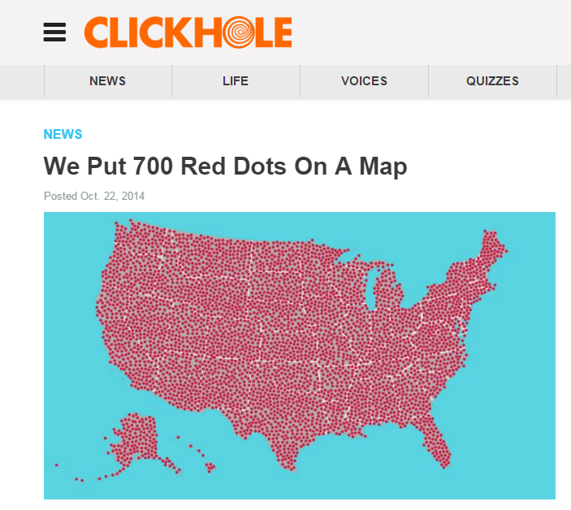<figcaption>Source: [Clickhole (The Onion)](https://clickhole.com/we-put-700-red-dots-on-a-map-1825122391/)</figcaption>

---

## Why map a billion points?

* Some datasets get this large when they count individuals: every job in the US, or every person in India
* Dot maps can show _mixing_ of groups that maps of counties or states will hide

---

## About me

* Professor and Chair of Geography at TCU
* Research: demographic change in US metropolitan areas
* Software: __tidycensus__, __tigris__, __mapgl__, __freestiler__
* Book: [_Analyzing US Census Data_](https://walker-data.com/census-r/)

---

## Dot-density mapping

* Dot-density maps scatter dots in proportion to the data; dots can be colored to show mixing of categories
* I've been making maps like this for over 10 years

---

### Educational Attainment in America

<iframe data-src="https://personal.tcu.edu/kylewalker/maps/education/" width="1000" height="520" frameborder="0"></iframe>

---

### Mapping Immigrant America

<iframe data-src="https://personal.tcu.edu/kylewalker/immigrant-america/" width="1000" height="520" frameborder="0"></iframe>

---

## Tiled mapping

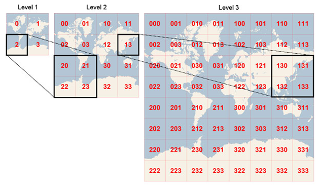

* _Vector tiles_: small pieces of data that your browser loads as you pan and zoom

---

## The old workflow

* Slow dot-generation pipelines, run state by state
* Hosting on Mapbox, which is expensive (but they've subsidized my work)
* A note in my code: "Re-instate this when the map views have calmed down"

---

## freestiler

* __freestiler__: R and Python package I wrote this year to build vector tiles directly from your data
* The output is a single file that can be hosted on inexpensive cloud storage

---

### 153 million jobs

<iframe data-src="https://walker-data.com/freestiler/lodes/" width="1000" height="500" frameborder="0"></iframe><figcaption>Data: 2024 LODES, US Census Bureau. Tiling took about 6 minutes on my laptop.</figcaption>

---

### 331 million people

<iframe data-src="https://walker-data.com/maps/census-2020/race.html" width="1000" height="500" frameborder="0"></iframe><figcaption>Data: 2020 Census. Dot locations are simulated within Census blocks.</figcaption>

---

## Dots, hexagons, or clusters?

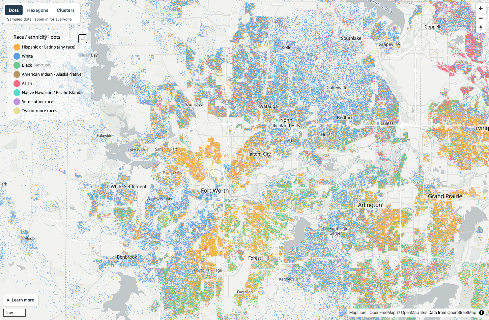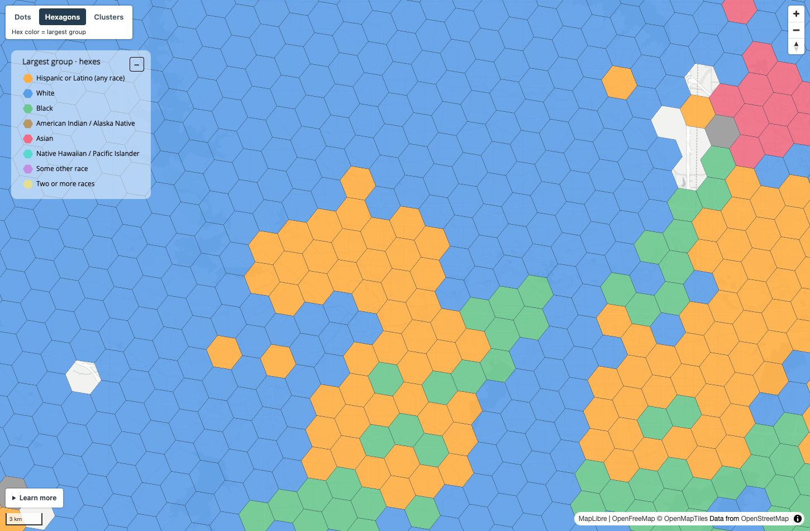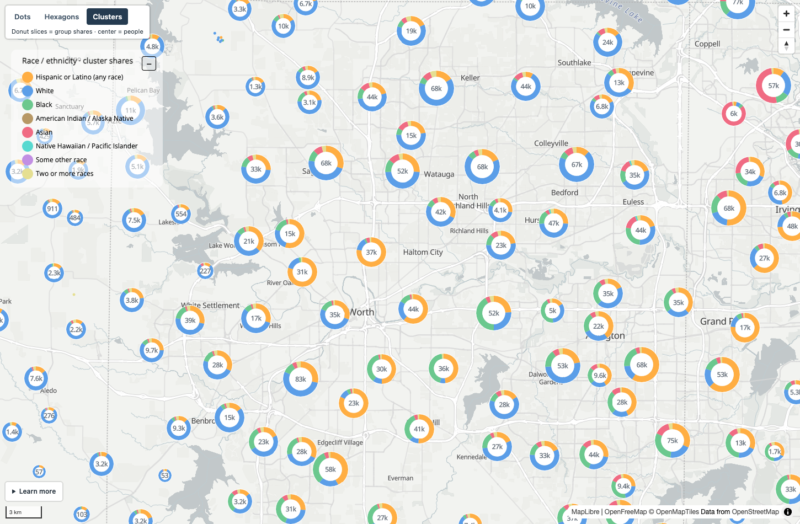

* Dots show density the best; hexagons show broad patterns; clusters show proportions

---

## Back to a billion points

* In April, my first attempt at a billion points failed
* Solution: split the data into smaller pieces, and tile them in parallel

---

## 1.47 billion dots

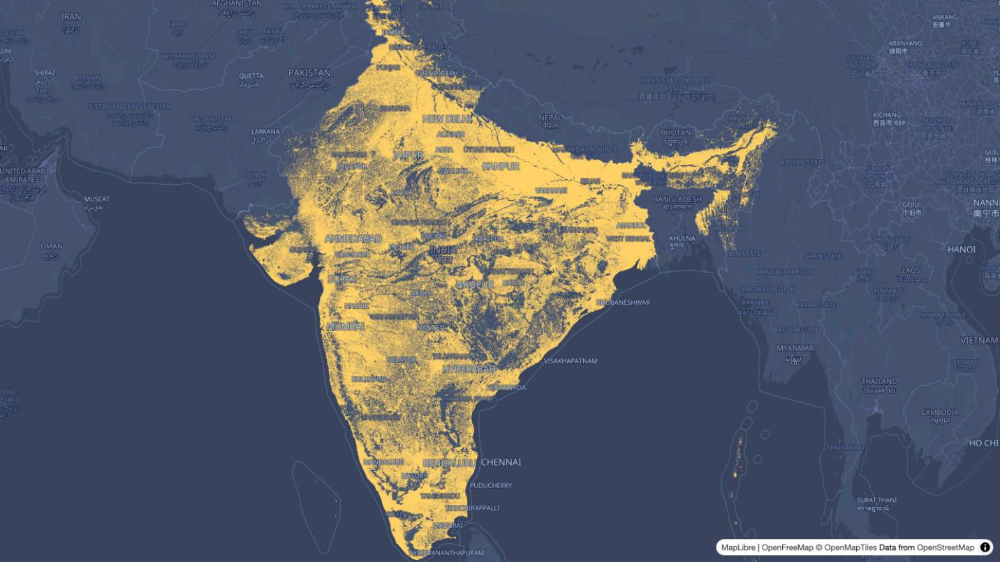

* 1 dot for every person in India; tiling took about 21 minutes on my MacBook

---

### Northern India

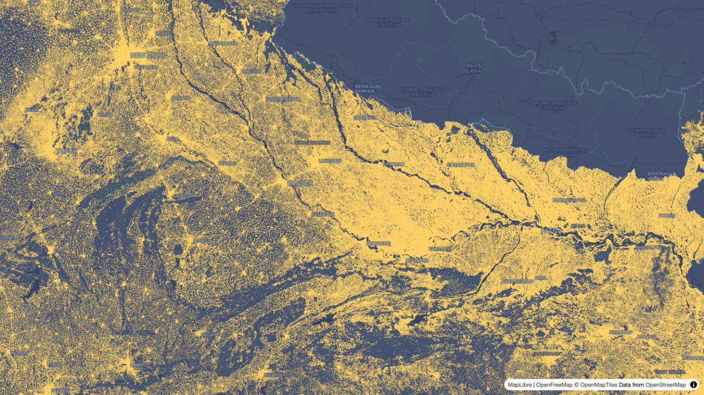

---

### Mumbai

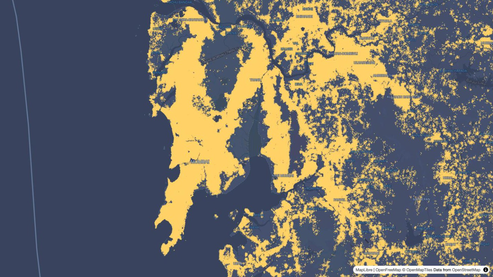

---

## The response

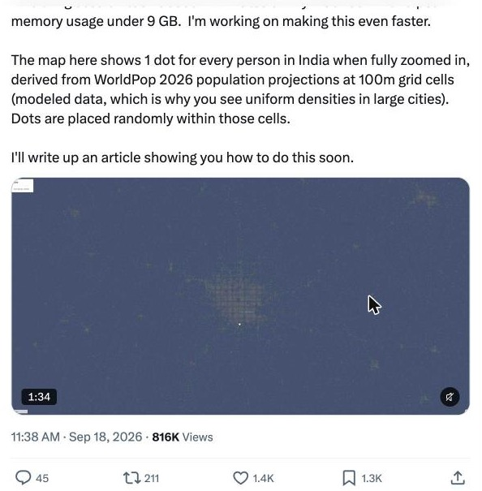

* Posted on X on September 18; viewed over 800,000 times
* Some viewers read the map very differently than I intended...

---

### The response

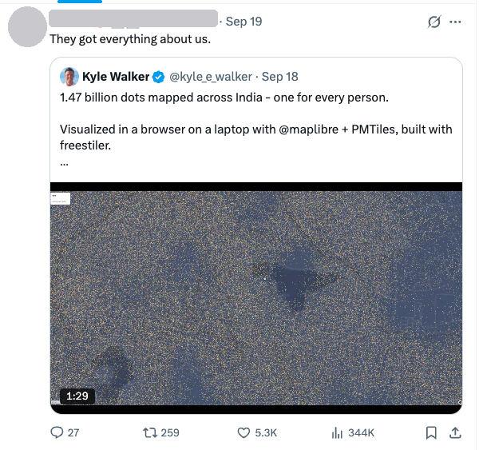

> "I don't remember giving consent to my data for this."

> "Everyone of you is marked digitally"

---

### The response

* Privacy: is this a database of where every person lives?
* Consent: who shared this data with a researcher in the US?
* Other viewers replied to explain that the data are modeled

---

## How the dots were made

* WorldPop is a _model_ of how many people live in each 100m grid cell; dots are placed randomly within those cells
* The dots do not represent the locations of individuals

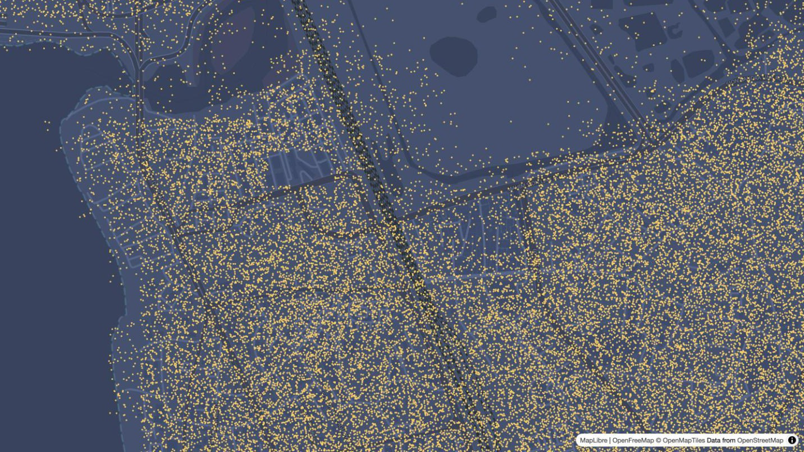<figcaption>Mumbai, fully zoomed in</figcaption>

---

## Should you map a billion points?

* The concern is reasonable: detailed dot maps look precise, regardless of how the data were made
* It may matter who is making the map, and who is being mapped
* For discussion: what do viewers assume when they can zoom in to a single dot?

---

## Thank you!

**Kyle Walker**

Professor & Chair of Geography, TCU

kyle@walker-data.com

[walker-data.com/freestiler](https://walker-data.com/freestiler)
